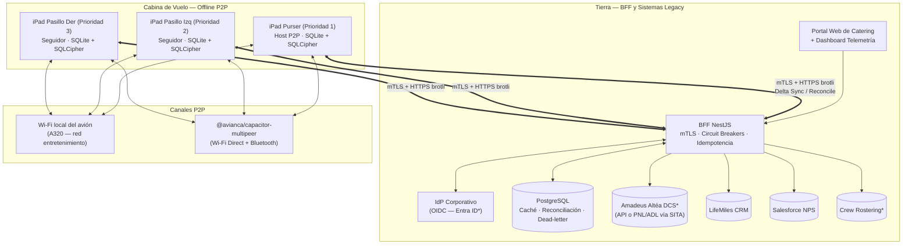
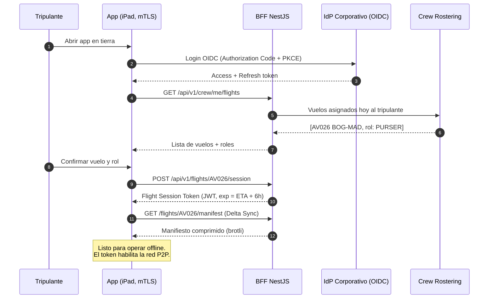
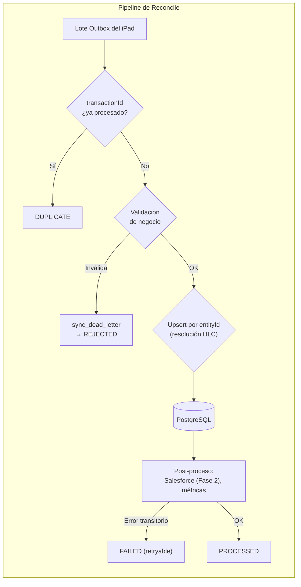
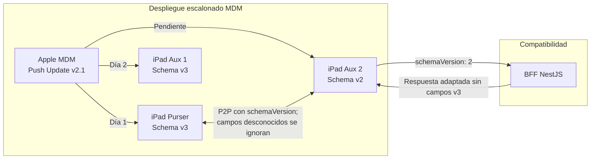
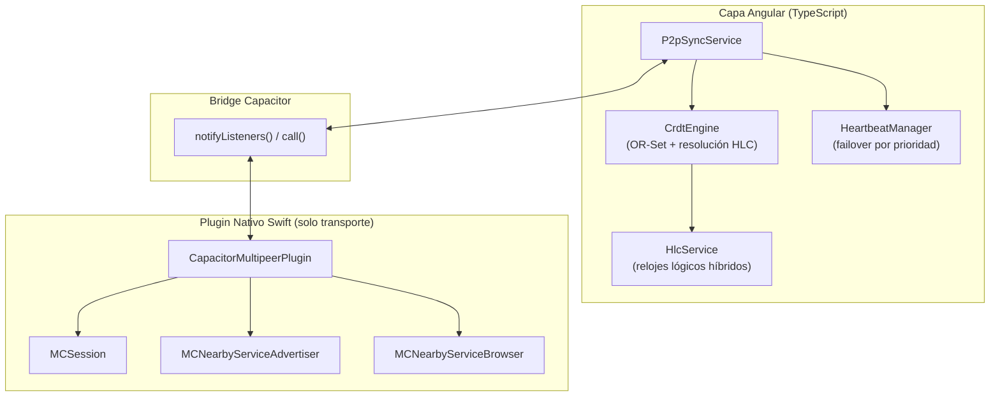
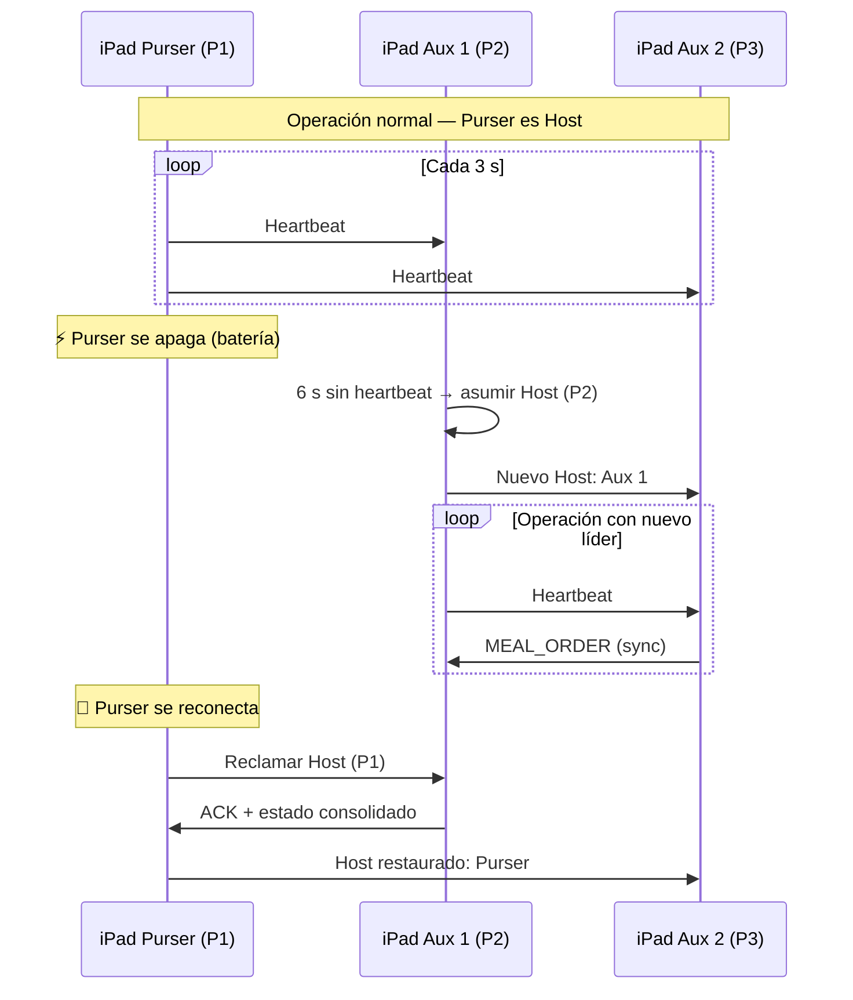
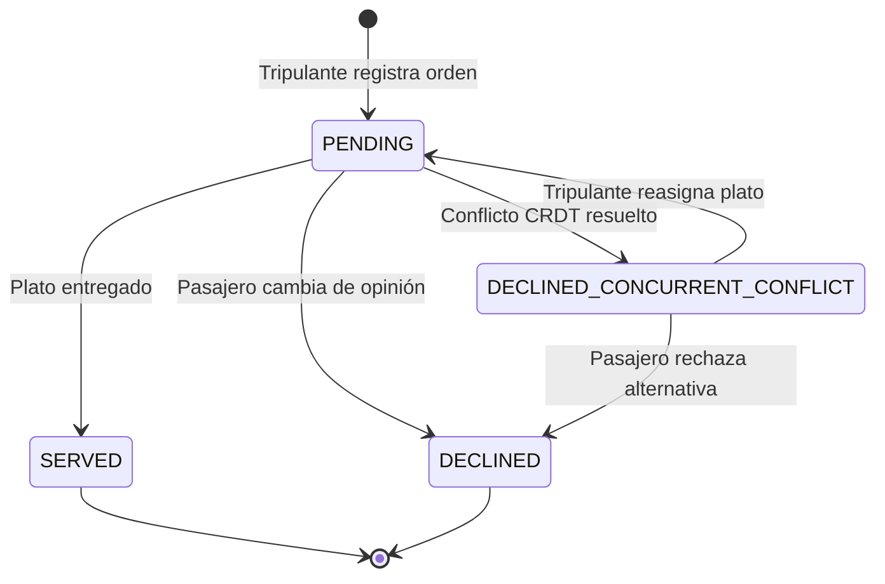
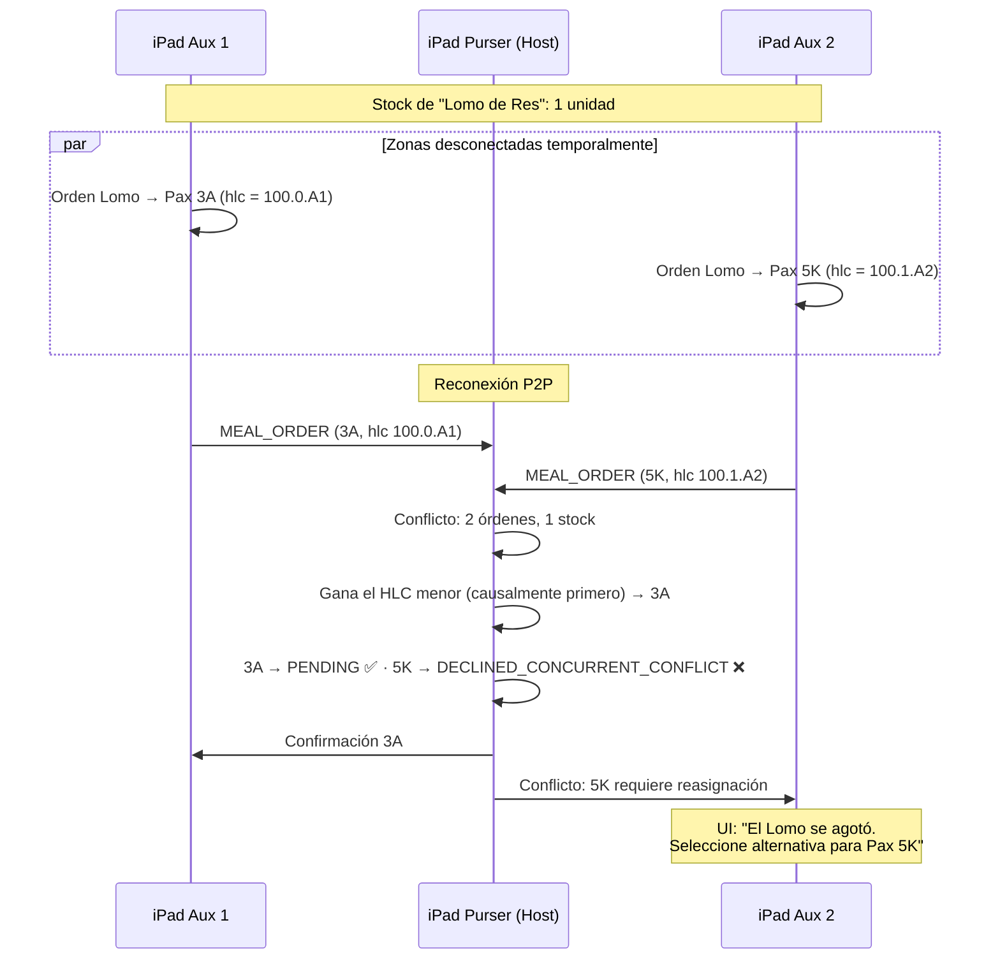
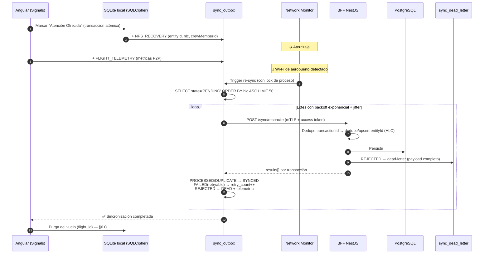

# Arquitectura Definitiva v3 — Avianca SeatMap Pro

> **Documento maestro de arquitectura.** Consolida y reemplaza a [`PROPUESTA_ARQUITECTURA.md`](./PROPUESTA_ARQUITECTURA.md) (v2), integrando las resoluciones de negocio de [`DECISIONES_ARQUITECTURA.md`](./DECISIONES_ARQUITECTURA.md) y los hallazgos técnicos de [`MEJORAS_PLAN_BACKEND.md`](./MEJORAS_PLAN_BACKEND.md). Los documentos anteriores se conservan como registro histórico del proceso de diseño.
>
> **Fecha:** 2026-07-17 · **Estado:** diseño aprobado para implementación, condicionado a las acciones pendientes A1–A9 (§14).

**Avianca SeatMap Pro** es un sistema de soporte operativo a bordo para tripulantes de cabina (TC): mapa de asientos, priorización de pasajeros Elite (LifeMiles), recuperación de servicio NPS y gestión de comandas de catering en Business. Opera **offline-first** durante el vuelo, se sincroniza **P2P entre iPads** en el aire y reconcilia bidireccionalmente con los sistemas de tierra al aterrizar.

---

## Índice

1. [Arquitectura general y fases operativas](#1-arquitectura-general-y-fases-operativas)
2. [Identidad, autenticación y autorización](#2-identidad-autenticación-y-autorización)
3. [Flujo de inicio de vuelo](#3-flujo-de-inicio-de-vuelo)
4. [Backend-For-Frontend (BFF) en NestJS](#4-backend-for-frontend-bff-en-nestjs)
5. [Modelo de datos del servidor (PostgreSQL)](#5-modelo-de-datos-del-servidor-postgresql)
6. [Base de datos local: SQLite nativo](#6-base-de-datos-local-sqlite-nativo)
7. [Sincronización P2P en vuelo](#7-sincronización-p2p-en-vuelo)
8. [Re-sincronización en tierra (Outbox)](#8-re-sincronización-en-tierra-outbox)
9. [Portal Web de Catering](#9-portal-web-de-catering)
10. [Seguridad en capas](#10-seguridad-en-capas)
11. [Privacidad, PII y cumplimiento](#11-privacidad-pii-y-cumplimiento)
12. [Observabilidad y telemetría](#12-observabilidad-y-telemetría)
13. [Estrategia de pruebas](#13-estrategia-de-pruebas)
14. [Roadmap y acciones pendientes](#14-roadmap-y-acciones-pendientes)

---

## 1. Arquitectura general y fases operativas

El ciclo de vida del sistema se divide en tres fases:

1. **Fase de Embarque (Tierra):** el tripulante hace login (OIDC), abre sesión de vuelo y la app (Angular + Capacitor) descarga el manifiesto con **Delta Sync** — pasajeros, SSR, tiers LifeMiles, alertas NPS de Salesforce e inventario de catering — desde el BFF, guardándolo en **SQLite nativo cifrado (SQLCipher)**. La ventana real de conectividad es de **10–15 minutos o menos** (los pasajeros modifican asientos hasta ~15 min antes del vuelo), por lo que la compresión y el delta sync son requisitos de primera clase, no optimizaciones.
2. **Fase de Vuelo (Offline – P2P):** sin conectividad externa. Los iPads sincronizan asignaciones de asientos, comandas (OR-Set CRDT) y stock de catering mediante el canal disponible: **Wi-Fi local del avión** (A320, red de entretenimiento) o **Apple Multipeer Connectivity** vía el plugin nativo `@avianca/capacitor-multipeer`. El orden causal de eventos lo garantizan **Relojes Lógicos Híbridos (HLC)**, no los relojes de pared.
3. **Fase de Desembarque (Tierra – Re-sync):** al recuperar conectividad, el motor de sincronización procesa la cola local (**Transactional Outbox**), incluida la telemetría de vuelo, contra `POST /sync/reconcile` con **respuesta por transacción** y **dead-letter** en el servidor. Al completar el reconcile, los datos del vuelo se purgan del iPad.



`*` Suposición pendiente de confirmar (acciones A1, A6, A8 — §14).

### Decisión de disponibilidad

El sistema **tolera el BFF caído por diseño**: los iPads vuelan autónomos y el Outbox reintenta indefinidamente con backoff. El BFF por tanto no requiere alta disponibilidad extrema; requiere **no perder datos** (backups + PITR + dead-letter). Esto abarata deliberadamente la infraestructura (§4.G).

---

## 2. Identidad, autenticación y autorización

El sistema maneja **cuatro identidades** distintas:

| Identidad | Mecanismo | Alcance |
|:----------|:----------|:--------|
| **Dispositivo (iPad)** | **mTLS** con certificados distribuidos por MDM (SCEP/ACME) | Ningún request llega a la capa de aplicación del BFF sin certificado corporativo válido |
| **Tripulante** | **OIDC** contra el IdP corporativo + **Flight Session Token** offline | Login en tierra; identidad y rol durante todo el vuelo sin red |
| **Personal de catering** | SSO corporativo, rol `CATERING_EDITOR` | Escritura de menús en el portal |
| **Equipo de TI/Ops** | SSO corporativo, rol `OPS_VIEWER` / `ADMIN` | Dashboard de telemetría (lectura) |

### A. El problema del token offline y el Flight Session Token

Un vuelo BOG–MAD dura ~10 horas sin red: un access token estándar (15–60 min) expira en el aire. Diseño en dos niveles:

1. **Access token OIDC de corta vida:** solo se usa cuando hay red (descarga del manifiesto, reconcile). En el reconcile post-vuelo el iPad se re-autentica con refresh token (`offline_access`) o re-login.
2. **Flight Session Token (JWT firmado por el BFF):** emitido al abrir la sesión de vuelo (§3). La app lo valida **offline** con la clave pública embebida.

```json
{
  "sub": "crew-4491",
  "crewMemberId": "crew-4491",
  "role": "PURSER",
  "p2pPriority": 1,
  "flightId": "AV026",
  "flightDate": "2026-07-07",
  "deviceId": "ipad-cabin-purser-01",
  "iat": 1783458000,
  "exp": 1783519200
}
```

- `exp` = hora estimada de llegada + **margen de 6 h** (desvíos, demoras).
- Toda transacción del Outbox y todo mensaje P2P lleva el `crewMemberId` de la sesión → **auditoría completa sin red**.
- La **prioridad P2P viaja firmada en el token** (`p2pPriority`): deja de ser configuración manual y los peers la validan en el handshake (§7.B).

### B. Autorización

- **BFF:** guards de NestJS por claim (`role`, `flightId`) — un iPad solo descarga/reconcilia el vuelo de su sesión activa.
- **Portal/Dashboard:** RBAC simple (`CATERING_EDITOR`, `OPS_VIEWER`, `ADMIN`) resuelto por grupos del IdP.
- Toda acción de escritura (app y portal) queda en `audit_log` (§5).

---

## 3. Flujo de inicio de vuelo

Resuelve cómo un iPad sabe **qué vuelo opera, con qué rol y con qué prioridad P2P** — insumo de la autenticación, la sesión offline y la topología P2P.



**Degradación:** si Rostering no responde (circuit breaker abierto), el tripulante selecciona vuelo y rol manualmente; la sesión se emite marcada como `assignmentSource: MANUAL` para auditoría.

Un iPad **sin sesión de vuelo activa no participa de la red P2P**: los peers verifican el claim `flightId` + firma del token en el handshake.

---

## 4. Backend-For-Frontend (BFF) en NestJS

El BFF aísla a los iPads de la complejidad y latencia de los sistemas legacy, y entrega un payload unificado, mínimo y comprimido.

### A. Superficie de API (contrato formal)

El contrato se define en **OpenAPI 3.1** versionado en el repositorio; de él se generan los tipos TypeScript de cliente y servidor. Errores en formato **RFC 9457 (`application/problem+json`)** con códigos de negocio estables (`UNKNOWN_MEAL_ID`, `STALE_SYNC_VERSION`, …). Regla de compatibilidad: **v1 nunca rompe**; los campos nuevos son siempre opcionales.

| Método | Endpoint | Descripción |
|:-------|:---------|:------------|
| `GET` | `/api/v1/crew/me/flights` | Vuelos asignados al tripulante (Rostering) |
| `POST` | `/api/v1/flights/:flightId/session` | Abre sesión de vuelo → Flight Session Token |
| `GET` | `/api/v1/flights/:flightId/manifest` | Manifiesto completo o delta (`?lastSyncVersion=N`) |
| `GET` | `/api/v1/flights/:flightId/catering` | Menú e inventario de catering del vuelo |
| `POST` | `/api/v1/sync/reconcile` | Recibe el Outbox del iPad (respuesta por transacción) |
| `GET` | `/api/v1/telemetry/…` | **Lectura** para el dashboard (la telemetría *entra* solo por el Outbox) |

> El tipo `SEAT_CHANGE` del Outbox es **informativo**: se persiste para análisis, pero no se escribe de vuelta al DCS (el DCS no acepta cambios post-vuelo).

### B. Agregación del manifiesto (adapters + Circuit Breaker)

El `ManifestAggregatorService` orquesta las fuentes **en paralelo, una vez por vuelo** (no por pasajero), y consolida el payload antes de cachearlo:

```
BFF NestJS
├── adapters/
│   ├── manifest-source/        ← puerto agnóstico (interfaz ManifestSource)
│   │   ├── amadeus-api.adapter.ts     ← si A1 confirma API SOAP/REST
│   │   ├── sita-pnl-adl.adapter.ts    ← si A1 confirma mensajería PNL/ADL
│   │   └── mock.adapter.ts            ← desarrollo y staging
│   ├── lifemiles.adapter.ts    ← tier Diamond/Gold/Silver
│   ├── salesforce.adapter.ts   ← alertas NPS
│   └── rostering.adapter.ts    ← asignación de tripulación
└── services/
    └── manifest-aggregator.service.ts
```

Cada adapter tiene su **Circuit Breaker independiente** (opossum: timeout 5 s, apertura al 50 % de fallos, half-open a los 30 s) con degradación parcial:

| Falla | Comportamiento |
|:------|:---------------|
| Amadeus/DCS | `FALLBACK_MODE`: el iPad opera con el último manifiesto cacheado |
| LifeMiles | Pasajeros se muestran como tier `REGULAR` |
| Salesforce | Pasajeros sin alerta NPS activa |
| Rostering | Selección manual de vuelo/rol (§3) |

> **Nota de estudio (A1):** la integración con Altéa probablemente **no es REST** — lo habitual es SOAP propietario (Amadeus Web Services) o mensajes **PNL/ADL vía SITA** (teletipo IATA, modelo *push*). Por eso el puerto `ManifestSource` es agnóstico y el desarrollo arranca contra el mock: la respuesta de A1 cambia un adapter, no el BFF. Si se confirma PNL/ADL, cada ADL alimenta naturalmente el Delta Sync (§4.D).

### C. Caché de manifiestos (protección de sistemas legacy)

Los GDS legacy tienen rate limits severos y cobran por transacción (suposición defensiva, A2):

- **Clave:** `{flightId, flightDate}` → **una sola consulta a legacy por vuelo**. El primer iPad (normalmente el Purser) llena la caché; los demás leen de PostgreSQL.
- **Frescura:** refresco si la caché supera 2 h; invalidación al recibir señal `DOOR_CLOSED` (si existe webhook) o manual por el Purser.

### D. Delta Sync con versionado y tombstones

`GET /api/v1/flights/:flightId/manifest?lastSyncVersion=N`

- **`sync_version` es un contador monotónico por vuelo**, incrementado por el BFF cada vez que el agregador detecta un cambio contra el snapshot cacheado (diff por entidad).
- Cada cambio se registra en `manifest_changes` con `operation: UPSERT | DELETE`. El delta para un cliente en versión N es la lista **compactada** de cambios con `sync_version > N` (una entrada final por entidad).
- **Tombstones:** la respuesta incluye borrados explícitos — sin ellos, un pasajero no-show/offloaded jamás desaparecería del iPad:

```json
{
  "syncVersion": 44,
  "baseVersion": 41,
  "changes": {
    "passengers": [ { "id": "pax-233", "seatId": "14C", "tier": "GOLD", "...": "..." } ],
    "seats":      [ { "id": "14C", "status": "OCCUPIED", "passengerId": "pax-233" } ]
  },
  "deletions": {
    "passengers": ["pax-187"],
    "seats": []
  }
}
```

El iPad aplica **primero las `deletions`, luego los upserts**. Si `lastSyncVersion` es demasiado antiguo (el vuelo se recacheó desde cero), el BFF responde `410 Gone` y el iPad hace descarga completa — evita historial infinito.

### E. Límites extremos de payload (ventana de 10–15 min)

| Parámetro | Decisión |
|:----------|:---------|
| **Peso máximo** | **< 200 KB comprimido** (objetivo: < 5 s en 4G/LTE) |
| **Compresión** | **brotli** (mejor ratio) con fallback a gzip, en todas las respuestas |
| **Fotos de pasajeros** | ❌ Nunca se descargan |
| **Fotos de platos** | ⚠️ Opcionales — solo si el total queda < 200 KB |
| **Delta Sync** | ✅ Obligatorio (crítico en conexiones/multi-tramo) |
| **Prioridad de datos** | 1.º Manifiesto + SSR · 2.º Tier LifeMiles · 3.º Alertas NPS · 4.º Catering |
| **Trigger de sync** | Al detectar Wi-Fi/4G **y** al abrir la app |
| **Timeout de descarga** | 8 s → modo degradado con datos anteriores |

Estimación para ~200 pax: ~46 KB sin comprimir → **~12 KB con brotli** (descarga < 1 s en 4G). ✅

### F. Reconcile: idempotencia en dos niveles y respuesta parcial

`POST /api/v1/sync/reconcile` — recibe el Outbox del iPad. Diseño clave:

**Idempotencia en dos niveles:**

1. **Nivel transporte — `transactionId` (UUID):** evita reprocesar el mismo envío ante reintentos HTTP (tabla `processed_transactions`).
2. **Nivel entidad — `entityId`:** cada hecho de negocio tiene un ID global generado por el dispositivo *origen* (`order-{flightId}-{seatId}-{uuid}`, `nps-{incidentId}`). El servidor hace **upsert por `entityId` con resolución HLC** — la misma comanda replicada por P2P y subida por los tres iPads (con `transactionId` distintos) converge a un único registro.

**Regla en el cliente:** los eventos recibidos por P2P se aplican a las tablas locales pero **no generan entradas nuevas en el Outbox** — cada iPad sube solo lo que originó. La subida redundante queda como red de seguridad (si el iPad origen muere, sus datos viajan en las réplicas), no como caso normal.

**Respuesta por transacción (nunca todo-o-nada):**

```json
{
  "results": [
    { "transactionId": "tx-1", "status": "PROCESSED" },
    { "transactionId": "tx-2", "status": "DUPLICATE" },
    { "transactionId": "tx-3", "status": "REJECTED", "reason": "UNKNOWN_MEAL_ID", "retryable": false },
    { "transactionId": "tx-4", "status": "FAILED",   "reason": "CRM_TIMEOUT",     "retryable": true }
  ]
}
```

- Las transacciones del lote se procesan **en orden HLC**, cada una en su propia transacción de BD.
- Todo `REJECTED` se persiste en **`sync_dead_letter`** con el payload completo: nada que un tripulante hizo en vuelo se pierde en silencio; Operaciones lo revisa desde el dashboard.
- La reacción del cliente a cada estado se detalla en §8.



### G. Infraestructura y despliegue

| Área | Decisión |
|:-----|:---------|
| **Runtime** | Contenedores; BFF stateless → réplicas detrás de un LB. Plataforma corporativa por definir (A9) |
| **Entornos** | `dev` → `staging` (mocks/sandbox de Amadeus y Salesforce) → `prod`. Staging es donde corren las pruebas de contrato |
| **PostgreSQL** | Gestionado, backups automáticos + PITR. **RPO ≤ 15 min, RTO ≤ 4 h** |
| **Secretos** | Vault/Secrets Manager corporativo — nunca variables de entorno planas con credenciales de legacy |
| **CI/CD** | Lint + tests + pruebas de contrato + pruebas de migración (cliente **y** servidor) |
| **Rate limiting / WAF** | Rate limit por certificado de dispositivo; WAF delante del portal (único componente expuesto a browsers) |

---

## 5. Modelo de datos del servidor (PostgreSQL)

Modelo conceptual que sustenta caché, delta sync, idempotencia, reconciliación, dead-letter y auditoría (afinar tipos/índices en implementación; migraciones con herramienta estándar bajo disciplina aditiva):

```sql
-- Vuelo operativo y ciclo de vida
CREATE TABLE flights (
  flight_id     TEXT NOT NULL,
  flight_date   DATE NOT NULL,
  origin        TEXT NOT NULL,
  destination   TEXT NOT NULL,
  aircraft_type TEXT,
  status        TEXT NOT NULL DEFAULT 'SCHEDULED'
                CHECK (status IN ('SCHEDULED','BOARDING','DEPARTED','RECONCILED','CLOSED')),
  PRIMARY KEY (flight_id, flight_date)
);

-- Caché del manifiesto consolidado (una consulta a legacy por vuelo)
CREATE TABLE flight_manifest_cache (
  flight_id     TEXT NOT NULL,
  flight_date   DATE NOT NULL,
  payload       JSONB NOT NULL,
  sync_version  INTEGER NOT NULL DEFAULT 1,
  cached_at     TIMESTAMPTZ NOT NULL DEFAULT NOW(),
  PRIMARY KEY (flight_id, flight_date)
);

-- Log de cambios por vuelo → alimenta el Delta Sync (incluye tombstones)
CREATE TABLE manifest_changes (
  flight_id     TEXT NOT NULL,
  flight_date   DATE NOT NULL,
  sync_version  INTEGER NOT NULL,
  entity_type   TEXT NOT NULL CHECK (entity_type IN ('PASSENGER','SEAT','MEAL')),
  entity_id     TEXT NOT NULL,
  operation     TEXT NOT NULL CHECK (operation IN ('UPSERT','DELETE')),
  payload       JSONB,
  created_at    TIMESTAMPTZ NOT NULL DEFAULT NOW(),
  PRIMARY KEY (flight_id, flight_date, sync_version, entity_type, entity_id)
);

-- Menús del Portal de Catering
CREATE TABLE catering_menus (
  id            TEXT PRIMARY KEY,
  flight_id     TEXT NOT NULL,
  flight_date   DATE NOT NULL,
  service       TEXT NOT NULL CHECK (service IN ('BREAKFAST','LUNCH','DINNER')),
  name          TEXT NOT NULL,
  description   TEXT,
  category      TEXT NOT NULL CHECK (category IN ('ENTREE','MAIN','DESSERT','BEVERAGE')),
  allergens     TEXT[],
  dietary_flags TEXT[],
  initial_stock INTEGER NOT NULL DEFAULT 0,
  photo_url     TEXT,
  created_by    TEXT NOT NULL,
  created_at    TIMESTAMPTZ NOT NULL DEFAULT NOW()
);

-- Idempotencia de transporte (purga programada, p. ej. 90 días)
CREATE TABLE processed_transactions (
  transaction_id TEXT PRIMARY KEY,
  device_id      TEXT NOT NULL,
  flight_id      TEXT NOT NULL,
  received_at    TIMESTAMPTZ NOT NULL DEFAULT NOW(),
  result         TEXT NOT NULL CHECK (result IN ('PROCESSED','DUPLICATE','REJECTED','FAILED'))
);

-- Estado consolidado de comandas (upsert por entity_id con resolución HLC)
CREATE TABLE meal_orders (
  entity_id        TEXT PRIMARY KEY,       -- order-{flightId}-{seatId}-{uuid}
  flight_id        TEXT NOT NULL,
  flight_date      DATE NOT NULL,
  passenger_id     TEXT NOT NULL,
  seat_id          TEXT NOT NULL,
  meal_id          TEXT NOT NULL,
  phase            TEXT NOT NULL,
  status           TEXT NOT NULL,
  hlc              TEXT NOT NULL,          -- HLC del último write ganador
  origin_device_id TEXT NOT NULL,
  crew_member_id   TEXT NOT NULL,
  updated_at       TIMESTAMPTZ NOT NULL DEFAULT NOW()
);

-- Recuperaciones NPS: fuente de verdad propia + máquina de estados de integración
CREATE TABLE nps_recoveries (
  entity_id        TEXT PRIMARY KEY,       -- nps-{incidentId}
  flight_id        TEXT NOT NULL,
  passenger_id     TEXT NOT NULL,
  incident_id      TEXT NOT NULL,
  crew_member_id   TEXT NOT NULL,
  resolved_at      TIMESTAMPTZ NOT NULL,
  crm_status       TEXT NOT NULL DEFAULT 'NOT_CONFIGURED'
                   CHECK (crm_status IN ('NOT_CONFIGURED','PENDING_CRM','SENT','FAILED'))
);

-- Telemetría P2P por vuelo y dispositivo (entra solo por el Outbox)
CREATE TABLE flight_telemetry (
  id             BIGSERIAL PRIMARY KEY,
  flight_id      TEXT NOT NULL,
  flight_date    DATE NOT NULL,
  device_id      TEXT NOT NULL,
  metrics        JSONB NOT NULL,           -- conflictos CRDT, reconexiones, cambios de líder, latencias
  reported_at    TIMESTAMPTZ NOT NULL
);

-- Dead-letter: transacciones rechazadas — nunca se descartan en silencio
CREATE TABLE sync_dead_letter (
  transaction_id TEXT PRIMARY KEY,
  device_id      TEXT NOT NULL,
  flight_id      TEXT,
  payload        JSONB NOT NULL,
  reason         TEXT NOT NULL,
  received_at    TIMESTAMPTZ NOT NULL DEFAULT NOW(),
  reviewed       BOOLEAN NOT NULL DEFAULT FALSE
);

-- Auditoría de acceso y escritura (requisito de cumplimiento — §11)
CREATE TABLE audit_log (
  id          BIGSERIAL PRIMARY KEY,
  actor_type  TEXT NOT NULL CHECK (actor_type IN ('CREW','PORTAL_USER','SYSTEM')),
  actor_id    TEXT NOT NULL,
  action      TEXT NOT NULL,               -- MANIFEST_READ, MEAL_ORDER_UPSERT, MENU_EDIT, ...
  flight_id   TEXT,
  detail      JSONB,
  occurred_at TIMESTAMPTZ NOT NULL DEFAULT NOW()
);
```

Notas:

- **`nps_recoveries.crm_status`** materializa la Fase 2 de Salesforce: cuando se confirme el proceso (A3), un worker recorre los `PENDING_CRM` — sin cambiar el contrato del iPad ni el esquema.
- **Retención por tabla** definida con Legal antes del piloto (§11): propuesta inicial — manifiestos cacheados 7 días, comandas/NPS 2 años agregados, `audit_log` según política corporativa.

---

## 6. Base de datos local: SQLite nativo

### A. Decisión: SQLite nativo directo (sin PowerSync, sin RxDB)

El patrón de datos del sistema es **descarga por lotes al inicio + operación 100 % local + subida por lotes al final** — no sincronización continua. Por eso:

- **RxDB descartado:** overhead del bridge JS↔nativo (serialización JSON constante) y degradación exponencial de los observables RxJS con colecciones grandes.
- **PowerSync descartado:** su valor es la sincronización bidireccional continua con Postgres, que este patrón no aprovecha; habría duplicado al Outbox como segundo motor de sync y añadido un servicio de infraestructura completo (con licencia) y una incógnita de compatibilidad con SQLCipher.

**Diseño adoptado:** `@capacitor-community/sqlite` (u OP-SQLite) **con SQLCipher**, consultas SQL directas, y reactividad resuelta en el `StoreService` con **Angular Signals** (que ya existe en la app). El Delta Sync (§4.D) cubre la bajada; el Outbox (§8) cubre la subida.

### B. Esquema local (con soporte multi-tramo)

Todas las tablas operativas llevan **`flight_id` + `flight_date`**: una tripulación de corto radio (A320) opera 4–6 tramos al día y cada tramo debe estar aislado.

```sql
-- migrations/001_initial_schema.sql

CREATE TABLE IF NOT EXISTS flights (
  flight_id     TEXT NOT NULL,
  flight_date   TEXT NOT NULL,
  origin        TEXT NOT NULL,
  destination   TEXT NOT NULL,
  aircraft_type TEXT,
  sync_version  INTEGER NOT NULL DEFAULT 0,   -- última versión delta aplicada
  session_state TEXT NOT NULL DEFAULT 'ACTIVE'
                CHECK (session_state IN ('ACTIVE','LANDED','RECONCILED','PURGED')),
  PRIMARY KEY (flight_id, flight_date)
);

CREATE TABLE IF NOT EXISTS passengers (
  id            TEXT NOT NULL,
  flight_id     TEXT NOT NULL,
  flight_date   TEXT NOT NULL,
  first_name    TEXT NOT NULL,
  last_name     TEXT NOT NULL,
  tier          TEXT NOT NULL CHECK (tier IN ('DIAMOND','GOLD','SILVER','REGULAR')),
  lifemiles_number TEXT,
  seat_id       TEXT,
  ssr           TEXT,                          -- JSON array: ["WCHR","VGML"]
  nps_has_alert     INTEGER DEFAULT 0,
  nps_incident_id   TEXT,
  nps_description   TEXT,
  nps_action_offered INTEGER DEFAULT 0,
  nps_resolved_at   TEXT,
  updated_at    TEXT NOT NULL DEFAULT (datetime('now')),
  PRIMARY KEY (id, flight_id, flight_date)
);

CREATE TABLE IF NOT EXISTS meal_orders (
  entity_id     TEXT PRIMARY KEY,              -- order-{flightId}-{seatId}-{uuid} (ID global de negocio)
  flight_id     TEXT NOT NULL,
  flight_date   TEXT NOT NULL,
  passenger_id  TEXT NOT NULL,
  seat_id       TEXT NOT NULL,
  meal_id       TEXT NOT NULL,
  phase         TEXT NOT NULL CHECK (phase IN ('WELCOME','DINNER','BREAKFAST')),
  status        TEXT NOT NULL CHECK (status IN ('PENDING','SERVED','DECLINED','DECLINED_CONCURRENT_CONFLICT')),
  hlc           TEXT NOT NULL,                 -- reloj lógico híbrido del último write
  ordered_at    TEXT NOT NULL,
  updated_at    TEXT NOT NULL DEFAULT (datetime('now')),
  origin_device_id TEXT NOT NULL,
  crew_member_id   TEXT NOT NULL
);

CREATE TABLE IF NOT EXISTS catering_inventory (
  id            TEXT NOT NULL,
  flight_id     TEXT NOT NULL,
  flight_date   TEXT NOT NULL,
  name          TEXT NOT NULL,
  category      TEXT NOT NULL,
  initial_stock INTEGER NOT NULL,
  -- current_stock SE CALCULA bajo demanda (vista), no se almacena
  updated_at    TEXT NOT NULL DEFAULT (datetime('now')),
  PRIMARY KEY (id, flight_id, flight_date)
);

CREATE TABLE IF NOT EXISTS sync_outbox (
  id            TEXT PRIMARY KEY,              -- transactionId (UUID)
  flight_id     TEXT NOT NULL,
  flight_date   TEXT NOT NULL,
  entity_id     TEXT,                          -- ID de negocio (dedupe nivel entidad en el servidor)
  hlc           TEXT NOT NULL,
  timestamp     TEXT NOT NULL,
  type          TEXT NOT NULL CHECK (type IN ('SEAT_CHANGE','NPS_RECOVERY','MEAL_ORDER','FLIGHT_TELEMETRY')),
  payload       TEXT NOT NULL,                 -- JSON serializado (incluye crewMemberId)
  state         TEXT NOT NULL DEFAULT 'PENDING'
                CHECK (state IN ('PENDING','SYNCED','DEAD')),
  retry_count   INTEGER DEFAULT 0,
  last_error    TEXT
);

-- Stock disponible en tiempo real (por vuelo)
CREATE VIEW IF NOT EXISTS catering_stock_available AS
SELECT
  ci.id, ci.flight_id, ci.flight_date, ci.name, ci.category, ci.initial_stock,
  ci.initial_stock - COALESCE(
    (SELECT COUNT(*) FROM meal_orders mo
     WHERE mo.meal_id = ci.id
       AND mo.flight_id = ci.flight_id AND mo.flight_date = ci.flight_date
       AND mo.status IN ('PENDING','SERVED')), 0
  ) AS available_stock
FROM catering_inventory ci;

CREATE INDEX IF NOT EXISTS idx_passengers_flight ON passengers(flight_id, flight_date);
CREATE INDEX IF NOT EXISTS idx_passengers_seat   ON passengers(flight_id, seat_id);
CREATE INDEX IF NOT EXISTS idx_meal_orders_seat  ON meal_orders(flight_id, seat_id);
CREATE INDEX IF NOT EXISTS idx_meal_orders_meal  ON meal_orders(flight_id, meal_id, status);
CREATE INDEX IF NOT EXISTS idx_outbox_pending    ON sync_outbox(state, hlc);
```

### C. Ciclo de vida del dato local (multi-tramo + purga)

```
ACTIVE → LANDED → RECONCILED → PURGED
```

- Cerrar sesión de vuelo → reconcile → **purga de ese `flight_id`** (borrado físico de pasajeros, comandas e inventario del tramo).
- **Tope duro:** purga a las 24 h del aterrizaje aunque el reconcile no haya completado — con el **Outbox como única excepción**: sus transacciones pendientes sobreviven (contienen el mínimo necesario) hasta vaciarse, aunque ya se opere el siguiente tramo.
- Esto implementa la política de retención de PII en el dispositivo (§11).

### D. Migraciones de esquema (despliegue escalonado MDM)

Dos iPads del mismo avión pueden llevar versiones distintas de la app durante 24–48 h:

1. Toda migración es **aditiva** (columnas/tablas/índices nuevos); nunca se elimina una columna en producción.
2. Columnas nuevas siempre con `DEFAULT`.
3. `schemaVersion` viaja en el payload de sincronización y en cada mensaje P2P; el receptor **ignora campos desconocidos** y el BFF adapta la respuesta a la versión del cliente.
4. Las migraciones corren automáticamente al iniciar la app.
5. El pipeline de CI/CD ejecuta **pruebas de migración N-2 → actual** sobre una BD poblada.



---

## 7. Sincronización P2P en vuelo

### A. Selección de canal por flota

Los iPads no tienen restricciones MDM sobre Bluetooth/Wi-Fi P2P (Q6 confirmada). Estrategia por tipo de avión:

| Flota | Canal principal | Fallback | Nota |
|:------|:----------------|:---------|:-----|
| **A320** | **Wi-Fi local** (red del sistema de entretenimiento) | Multipeer Connectivity | Más ancho de banda y estabilidad. Pendiente confirmar *client isolation* (A4) |
| **B787** | **Multipeer Connectivity** | Bluetooth puro | Pendiente confirmar access point para tripulación (A5) |

```typescript
// P2pSyncService — selección automática de canal (diseño)
async selectSyncChannel(): Promise<'WIFI_LOCAL' | 'MULTIPEER'> {
  const net = await Network.getStatus();
  if (net.connected && net.connectionType === 'wifi') {
    // Red del avión sin internet: ping a peer local con timeout 500 ms
    if (await this.pingLocalPeers()) return 'WIFI_LOCAL';
  }
  return 'MULTIPEER';
}
```

La capa de mensajería (§7.C) es **agnóstica del transporte**: el mismo protocolo viaja por sockets sobre la LAN del avión o por MPC.

### B. Plugin nativo `@avianca/capacitor-multipeer`

No existe plugin oficial ni comunitario mantenido de Capacitor para Multipeer Connectivity → se desarrolla un **plugin Swift propio** como módulo npm independiente.



**Separación estricta de responsabilidades:**

| Capa | Responsabilidad |
|:-----|:----------------|
| **Swift** | Solo transporte: descubrir peers, conectar, enviar/recibir bytes |
| **TypeScript** | Toda la lógica: HLC, heartbeats, failover, serialización, CRDT, consolidación de stock |

Esto permite probar toda la lógica P2P en Jest sin dispositivos físicos.

```typescript
// API pública del plugin
export interface MultipeerPlugin {
  startAdvertising(options: { serviceType: string; displayName: string }): Promise<void>;
  startBrowsing(options: { serviceType: string }): Promise<void>;
  sendData(options: { data: string; peerId?: string }): Promise<void>;
  disconnect(): Promise<void>;
  addListener(event: 'dataReceived', handler: (msg: { peerId: string; data: string }) => void): Promise<void>;
  addListener(event: 'peerStateChanged', handler: (info: { peerId: string; state: 'connected' | 'disconnected' | 'connecting' }) => void): Promise<void>;
}
```

**Estimación:** prototipo 2 sem → integración con Angular + dispositivos reales 2 sem → hardening (reconexión, certificados MDM) 1–2 sem = **5–6 semanas**.

### C. Topología: estrella con prioridad estática firmada

Para 2–4 nodos, un protocolo de consenso (Bully) es sobreingeniería. La prioridad es **estática y viaja firmada en el Flight Session Token** (`p2pPriority`, §2.A) — nadie la configura a mano y los peers la verifican en el handshake:

| Prioridad | Rol | Comportamiento |
|:---------:|:----|:---------------|
| **1** | iPad Purser | Host por defecto |
| **2** | iPad Pasillo Izq (Aux 1) | Asume host si el 1 no responde en 6 s |
| **3** | iPad Pasillo Der (Aux 2) | Segundo fallback |

**Failover determinista:** heartbeat cada **3 s**; 2 heartbeats perdidos (**6 s**) → el siguiente en prioridad asume el host **sin votación**; al reconectar, el Purser reclama el rol por prioridad superior. Cada cambio de líder se registra en telemetría.



### D. Relojes Lógicos Híbridos (HLC)

Los iPads pasan 10+ horas sin NTP: la deriva de reloj es inevitable y un reloj mal configurado rompería un LWW basado en hora de pared en silencio. Por eso **el orden de los eventos lo dictan HLC, nunca `Date.now()`**:

- Cada evento lleva `hlc = (physicalTime, logicalCounter, deviceId)`. El HLC local se actualiza con cada mensaje P2P recibido → **orden causal garantizado** aunque los relojes deriven (~50 líneas de TypeScript, determinista de probar).
- **Desempate total:** a igualdad de HLC gana el `deviceId` menor. Los tres iPads llegan a la misma conclusión sin coordinarse; no existen empates irresolubles.
- **Chequeo de sanidad en tierra:** el manifiesto incluye la hora del BFF; si el desfase del iPad supera 30 s, se registra en telemetría y se advierte al tripulante.
- Los `timestamp` ISO se conservan en los payloads para lectura humana y del servidor; el servidor también resuelve upserts concurrentes por HLC (§4.F).

### E. Protocolo de mensajería

```typescript
interface P2PMessage {
  messageId: string;        // UUID
  senderId: string;         // deviceId del emisor
  crewMemberId: string;     // de la sesión de vuelo (auditoría)
  flightId: string;         // los peers rechazan mensajes de otro vuelo
  hlc: string;              // reloj lógico híbrido del evento
  timestamp: string;        // ISO — solo informativo
  schemaVersion: number;    // compatibilidad entre versiones de app
  action: 'SEAT_ASSIGNMENT' | 'MEAL_ORDER' | 'STOCK_SYNC' | 'NPS_RESOLVED' | 'HEARTBEAT' | 'LEADER_CLAIM';
  payload: unknown;
}
```

**Regla de replicación:** un mensaje recibido por P2P actualiza las tablas locales pero **no** entra al Outbox del receptor — cada iPad sube a tierra solo lo que originó (§4.F).

### F. Resolución de conflictos: OR-Set de comandas con máquina de estados

Se sincroniza un **OR-Set** de comandas individuales (no un contador): cada comanda tiene ciclo de vida propio y el stock se **calcula**, nunca se almacena:

```
Stock Disponible = Stock Inicial − Count(comandas con status IN ('PENDING','SERVED'))
```

(implementado como la vista `catering_stock_available`, §6.B).



**Conflicto concurrente (último plato):**



---

## 8. Re-sincronización en tierra (Outbox)

### A. Escritura atómica local

Toda acción del tripulante ejecuta **una transacción SQLite atómica**: actualización de la tabla operativa + inserción en `sync_outbox` (con `entityId`, `hlc`, `crewMemberId` y `flightId`). O ambas ocurren, o ninguna.

### B. Ciclo de vida del Outbox



### C. Reglas del cliente

- **Lock de proceso:** el listener de red no puede disparar dos envíos concurrentes del mismo lote (la conectividad de aeropuerto parpadea).
- **Backoff exponencial con jitter** entre reintentos de lotes fallidos.
- **Estados terminales:** `REJECTED (retryable: false)` → la transacción pasa a `DEAD` localmente, se reporta en telemetría y **nunca se reintenta** — su copia íntegra vive en `sync_dead_letter` del servidor para revisión humana.
- El Outbox de tramos anteriores sobrevive a la purga del vuelo hasta vaciarse (§6.C).

---

## 9. Portal Web de Catering

No existe API de catering en la aerolínea: se construye un **portal administrativo** (módulo del mismo BFF NestJS o app Next.js separada) para que el equipo de catering registre el menú e inventario de cada vuelo, y la API que lo sirve al iPad.

**Campos por vuelo:** `flightId`, `flightDate`, `origin/destination`, `service` (`BREAKFAST`/`LUNCH`/`DINNER`) y `meals[]`:

| Campo | Tipo | Descripción |
|:------|:-----|:------------|
| `name` / `description` | Text | Nombre y descripción del plato |
| `category` | Enum | `ENTREE` / `MAIN` / `DESSERT` / `BEVERAGE` |
| `allergens` | Tags | `GLUTEN`, `DAIRY`, `NUTS`, `SHELLFISH`, `SOY`, … |
| `dietaryFlags` | Tags | `VEGETARIAN`, `VEGAN`, `HALAL`, `KOSHER`, `GLUTEN_FREE` |
| `initialStock` | Integer | Unidades físicamente cargadas al avión |
| `photoUrl` | Text? | Opcional — sujeto al límite de payload (§4.E) |

Decisiones:

- **Auth:** SSO corporativo con rol `CATERING_EDITOR` (§2.B); toda edición queda en `audit_log`.
- Persistencia en `catering_menus` (§5); el iPad consume `GET /flights/:flightId/catering` — **si en el futuro aparece una API real de catering, solo cambia el origen de datos**; el contrato del iPad no se toca.
- Es el único componente expuesto a navegadores → **WAF delante** (§4.G).
- **Estimación:** 2–3 semanas, **en paralelo** a la Fase 1 del BFF.

---

## 10. Seguridad en capas

```mermaid
graph TB
    subgraph "Capa 0: Identidad"
        MTLS["mTLS con certificados MDM<br/>(identidad de dispositivo)"]
        OIDC["OIDC + Flight Session Token<br/>(identidad de tripulante, válida offline)"]
        MTLS --- OIDC
    end

    subgraph "Capa 1: Datos en reposo (iPad)"
        SQLC["SQLCipher AES-256<br/>(cifrado a nivel de página)"]
        KC["iOS Keychain + Secure Enclave<br/>(protección de la llave)"]
        SQLC --- KC
    end

    subgraph "Capa 2: Tránsito P2P (vuelo)"
        MPC_SEC["MPC: cifrado nativo +<br/>securityIdentity con certs MDM"]
        TOKCHK["Handshake: validación del<br/>Flight Session Token (flightId, prioridad)"]
        MPC_SEC --- TOKCHK
    end

    subgraph "Capa 3: Tránsito HTTPS (tierra)"
        TLS["TLS 1.3 + mTLS"]
        PIN["SSL Pinning con rotación segura"]
        TLS --- PIN
    end

    subgraph "Capa 4: Dispositivo (MDM)"
        MDM_P["Passcode obligatorio · Supervisado<br/>App Lock · Remote Wipe"]
    end
```



1. **En reposo:** SQLCipher (AES-256 por página); llave en Keychain protegida por Secure Enclave. A diferencia de Apple Data Protection, la BD permanece cifrada incluso con el iPad desbloqueado.
2. **Tránsito P2P:** cifrado nativo de MPC + `securityIdentity` con certificados del enrolamiento MDM; el handshake además valida el Flight Session Token del peer (mismo `flightId`, prioridad firmada).
3. **Tránsito HTTPS:** TLS 1.3 + **mTLS** (§2) + SSL Pinning con reglas anti-brickeo:
   - Se pinea **la clave pública de la CA intermedia propia**, no el certificado hoja.
   - **Siempre dos pines** (activo + backup); rotación en dos releases (añadir pin nuevo → rotar cert → retirar pin viejo).
   - **Kill-switch vía MDM** (managed app config) para desactivar pinning en emergencia — el canal MDM es en sí autenticado.
4. **Dispositivo:** políticas MDM — passcode, supervisión con App Lock, Remote Wipe.
5. **Perímetro del BFF:** rate limiting por certificado de dispositivo; WAF delante del portal.

---

## 11. Privacidad, PII y cumplimiento

El manifiesto contiene **datos sensibles**: los SSR incluyen datos de salud (WCHR/WCHS/WCHC, POC, dietas médicas) y situaciones legales (deportados). Marco aplicable:

- **Colombia:** Ley 1581/2012 (Habeas Data) — los datos de salud son *datos sensibles* con régimen reforzado.
- **UE:** la ruta piloto es BOG–**MAD** → aplica **GDPR** (art. 9, categorías especiales).

| Principio | Implementación |
|:----------|:---------------|
| **Minimización** | El BFF filtra el manifiesto a lo estrictamente operativo: si la cabina no lo necesita para actuar, no viaja al iPad (sin fotos de pasajeros — ya decidido por payload; aquí es además principio legal) |
| **Retención en iPad** | Purga automática por vuelo al completar el reconcile; tope duro 24 h post-aterrizaje (§6.C) |
| **Retención en servidor** | Por tabla, definida con Legal antes del piloto (propuesta: manifiestos 7 días, comandas/NPS 2 años agregados, `audit_log` según política corporativa) |
| **Auditoría** | Toda lectura de manifiesto y toda escritura con `crewMemberId`/usuario en `audit_log` (§5) — posible gracias a §2 |
| **Evaluación de impacto** | **DPIA/PIA antes del piloto** BOG–MAD — gate del roadmap, no opcional (§14) |

---

## 12. Observabilidad y telemetría

### A. Telemetría de cabina — un solo camino de entrada

`FLIGHT_TELEMETRY` viaja **exclusivamente como transacción del Outbox** (hereda idempotencia, reintentos y orden). No existe endpoint POST dedicado; `GET /api/v1/telemetry/…` es solo lectura para el dashboard. Métricas por vuelo/dispositivo:

- Conflictos CRDT resueltos · reconexiones P2P · cambios de líder · latencia media P2P (envío→ACK) · estado del Outbox al aterrizar · desfase de reloj detectado en tierra (§7.D) · transacciones `DEAD`.

### B. Observabilidad del servidor

- **Logs estructurados** (JSON) con `flightId` y `deviceId` como campos de correlación en todo el pipeline de reconcile.
- **Métricas** (OpenTelemetry → stack corporativo): estado de circuit breakers por adapter, latencia/errores por sistema legacy, profundidad de `sync_dead_letter`, vuelos sin reconcile completo.
- **Alertas mínimas del piloto:**
  1. Circuit breaker de Amadeus abierto > 10 min en ventana de embarque.
  2. Vuelo aterrizado sin reconcile de **ningún** iPad tras 2 h.
  3. Crecimiento sostenido de `sync_dead_letter`.
- **Dashboard "salud del vuelo":** ¿sincronizaron los 3 iPads? ¿cuántos conflictos hubo? ¿algo en dead-letter? — combina `flight_telemetry` + métricas de servidor.

---

## 13. Estrategia de pruebas

### A. Unitarias (TypeScript/Jest — sin dispositivos)

| Módulo | Qué se prueba |
|:-------|:--------------|
| `HlcService` | Monotonicidad, merge de relojes remotos, desempate por `deviceId`, deriva simulada de reloj físico |
| `CrdtEngine` | OR-Set de comandas, resolución por HLC, cálculo de stock, convergencia de 3 réplicas |
| `HeartbeatManager` | Detección de desconexión, failover por prioridad, reclamo del Purser (timers simulados) |
| `OutboxService` | Escritura atómica, respuesta parcial (`PROCESSED`/`REJECTED`/`FAILED`), backoff, lock de proceso, estados `DEAD` |
| `SyncService` | Delta sync con tombstones, `410 Gone` → full sync, compatibilidad de `schemaVersion` |
| **BFF: reconcile** | Doble idempotencia (transporte + entidad), orden HLC del lote, ruteo a dead-letter |

### B. Contrato e integración (staging)

- **Pruebas de contrato** del OpenAPI contra los mocks/sandboxes de Amadeus y Salesforce en staging.
- **Concurrencia extrema:** dos tablets ordenando el último plato simultáneamente con 50 % de pérdida de paquetes.
- **Failover:** apagar el iPad Purser durante una comanda activa; verificar que Aux 1 asume y completa.
- **Versiones mixtas:** iPad con schema v2 y otro con v3 comunicándose por P2P sin pérdida de datos.
- **Reconcile triple:** los 3 iPads suben réplicas del mismo vuelo → el servidor converge a un único estado (dedupe por `entityId`).
- **Carga:** oleada de reconciles simultáneos (hub: decenas de vuelos aterrizando en la misma hora).

### C. Migraciones (CI/CD)

- Cada release ejecuta migraciones **cliente y servidor** desde N-2 hasta la actual sobre BDs pobladas; se valida integridad de datos e índices y compatibilidad hacia atrás del payload.

---

## 14. Roadmap y acciones pendientes

### A. Roadmap

Cambios respecto a v2: se antepone una **Fase 0 de descubrimiento** (bloqueantes externos), la Fase 1 del BFF crece para absorber auth, modelo de datos servidor, delta sync con tombstones y reconcile parcial; la **eliminación de PowerSync devuelve ~1 semana** (capa SQLite propia es más simple); el **Portal de Catering corre en paralelo** a la Fase 1; y se añade un **gate legal** antes del piloto.

```mermaid
gantt
    title Roadmap — Avianca SeatMap Pro v3
    dateFormat  YYYY-MM-DD
    axisFormat  %b %d

    section Fase 0 · Descubrimiento
    A1 SITA/Amadeus · A6 IdP+mTLS · A8 Rostering · A9 Infra :f0, 2026-07-20, 2w
    Sesión Legal/DPO (A7) + OpenAPI v1 draft + mock ManifestSource :f0b, 2026-07-20, 2w

    section Fase 1 · Backend y Fundamentos
    BFF NestJS (auth, delta sync, reconcile, modelo PG) :f1, after f0, 5w
    Infra transversal (entornos, CI/CD, secretos, o11y) :inf, after f0, 2w
    Esquema SQLite + migraciones (flight_id) :f2, after f0, 2w
    Capa SQLite nativa + acceso a datos (Signals) :f3, after f2, 1w
    Portal Web de Catering :cat, after f0, 3w

    section Fase 2 · Plugin Nativo P2P
    Plugin Swift: prototipo :p1, after f0, 2w
    Plugin Swift: integración + dispositivos reales :p2, after p1, 2w
    Plugin Swift: hardening + certificados MDM :p3, after p2, 2w

    section Fase 3 · Lógica de Negocio P2P
    HLC + CRDT Engine (OR-Set) :c1, after f3, 2w
    Heartbeat + prioridad firmada + selección de canal :c2, after c1, 1w
    Outbox + telemetría :c3, after c2, 2w

    section Fase 4 · Seguridad y QA
    SQLCipher + Keychain :s1, after p3, 1w
    mTLS + SSL Pinning + rotación :s2, after s1, 1w
    Pruebas de integración en iPads :t1, after c3, 2w
    Pruebas de migración y carga (CI/CD) :t2, after s2, 1w

    section Fase 5 · Piloto
    Gate legal: DPIA aprobada (A7) :milestone, gate, after t1, 0d
    Piloto en ruta BOG–MAD :pilot, after t1, 2w
```

**Neto estimado vs. v2:** +3 a +4 semanas hasta el piloto — concentradas en descubrimiento y autenticación, trabajo que habría aparecido igual pero en mitad de la implementación y con rediseños.

### B. Decisiones técnicas consolidadas

| # | Decisión | Fuente |
|:--|:---------|:-------|
| D1 | `ManifestAggregatorService`: llamadas paralelas con Circuit Breaker independiente por adapter y degradación parcial | v2/Q1 |
| D2 | Caché de manifiestos en PostgreSQL por `{flightId, flightDate}` — 1 llamada a legacy por vuelo | Q2 |
| D3 | NPS Recovery persiste primero en BD propia (`crm_status`); Salesforce en Fase 2 sin cambiar contrato | Q4 |
| D4 | Portal Web de Catering + API propia, preparada para API externa futura | Q5 |
| D5 | A320: Wi-Fi local preferido, MPC fallback; B787: MPC principal | Q6 |
| D6 | Payload < 200 KB brotli, sin fotos de pasajero, Delta Sync obligatorio, timeout 8 s | Q7 |
| D7 | **SQLite nativo directo + Outbox** — PowerSync y RxDB descartados | H2 |
| D8 | **mTLS (certs MDM) + OIDC + Flight Session Token** con prioridad P2P firmada | H1/H9 |
| D9 | **HLC** para todo orden de eventos; desempate por `deviceId`; LWW de pared eliminado | H3 |
| D10 | **Idempotencia en dos niveles** (`transactionId` + `entityId`); réplicas P2P no entran al Outbox | H4 |
| D11 | Delta Sync con `sync_version` monotónico, **tombstones** y escape `410 Gone` | H6 |
| D12 | Reconcile con **respuesta por transacción** + `sync_dead_letter`; backoff + lock en cliente | H8 |
| D13 | `flight_id` en todo el esquema local; purga por vuelo post-reconcile (tope 24 h) | H15/H7 |
| D14 | Telemetría entra **solo** por el Outbox; endpoint dedicado eliminado | H12 |
| D15 | OpenAPI 3.1 + RFC 9457 como contrato formal; v1 nunca rompe | H14 |
| D16 | SSL Pinning sobre CA intermedia, doble pin, kill-switch MDM | H16 |

### C. Acciones pendientes (bloqueantes externos)

| # | Acción | Bloquea |
|:--|:-------|:--------|
| A1 | Confirmar proveedor DCS real **y modalidad** (API SOAP/REST vs **PNL/ADL vía SITA**) | Adapter de manifiesto; estimación Fase 1 |
| A2 | Verificar contrato Bulk API con el GDS | Estrategia de caché |
| A3 | Definir proceso de cierre de casos NPS en Salesforce | Worker `PENDING_CRM` (Fase 2) |
| A4 | Confirmar *client isolation* en el Wi-Fi del A320 | Canal principal A320 |
| A5 | Confirmar access point del B787 para tripulación | Estrategia MPC B787 |
| A6 | Confirmar IdP corporativo y viabilidad de mTLS con certificados MDM (SCEP/ACME) | Toda la capa de identidad (§2) |
| A7 | Sesión Legal/DPO: bases legales, retención, **DPIA ruta BOG–MAD** | **Gate del piloto** |
| A8 | Identificar sistema de Crew Rostering y su API | Flujo de inicio de vuelo (§3) |
| A9 | Definir plataforma de despliegue y topología de red del BFF | Infraestructura (§4.G) |

---

> **Resumen ejecutivo:** la columna vertebral del sistema — tres fases operativas, BFF con circuit breakers, Outbox transaccional, OR-Set con prioridad estática — se conserva de v2. Esta versión completa la mitad que faltaba: identidad de extremo a extremo (mTLS + sesión de vuelo offline), orden causal con HLC en lugar de relojes de pared, idempotencia real entre dispositivos, el modelo de datos del servidor con dead-letter, el ciclo de vida completo del dato (versiones, tombstones, multi-tramo, purga y cumplimiento) y la plataforma donde todo corre. Con las acciones A1 y A6 resueltas en la Fase 0, el resto del plan es ejecutable tal como está escrito.
