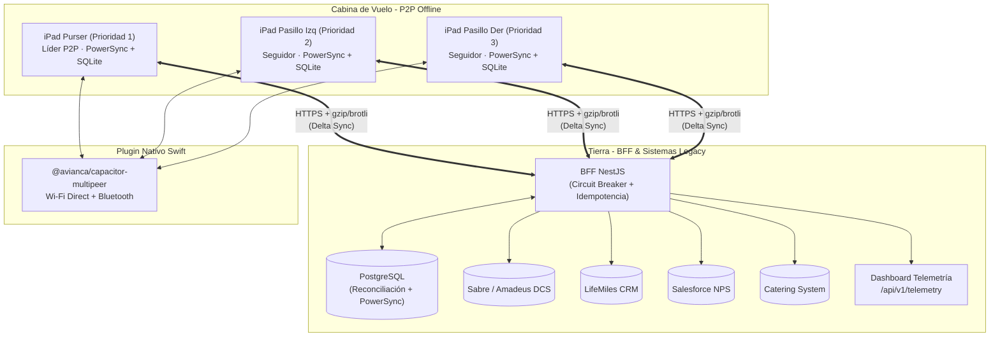
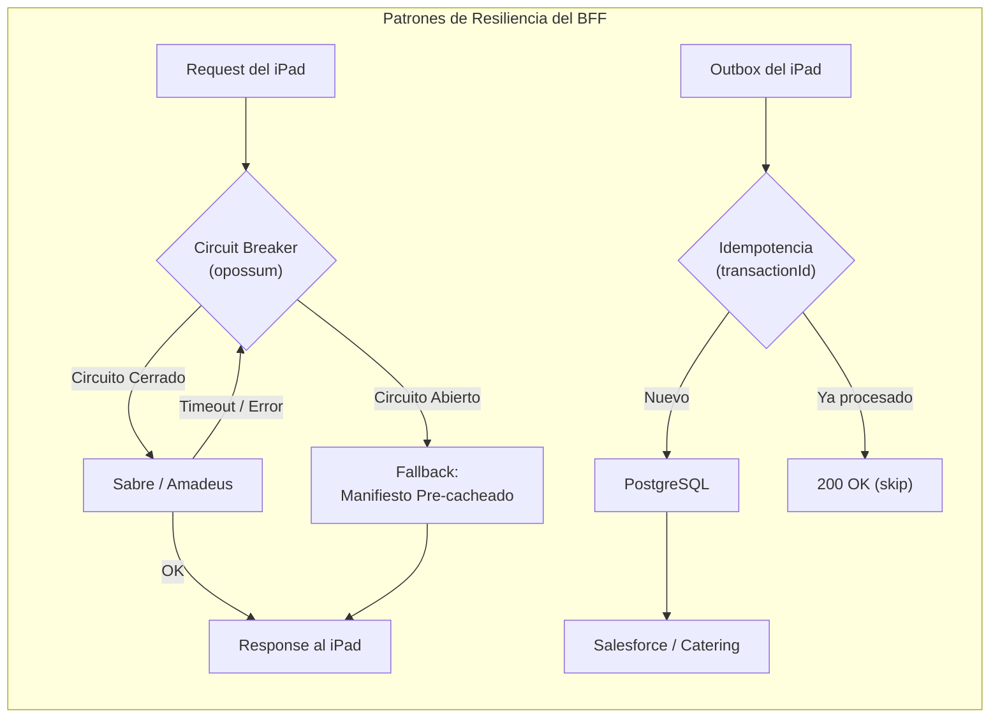
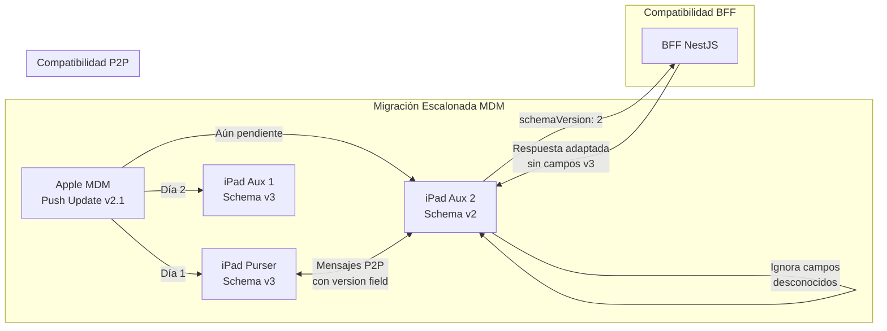
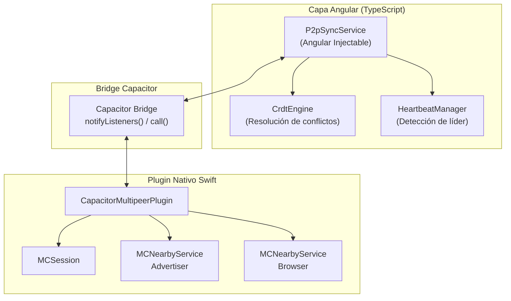
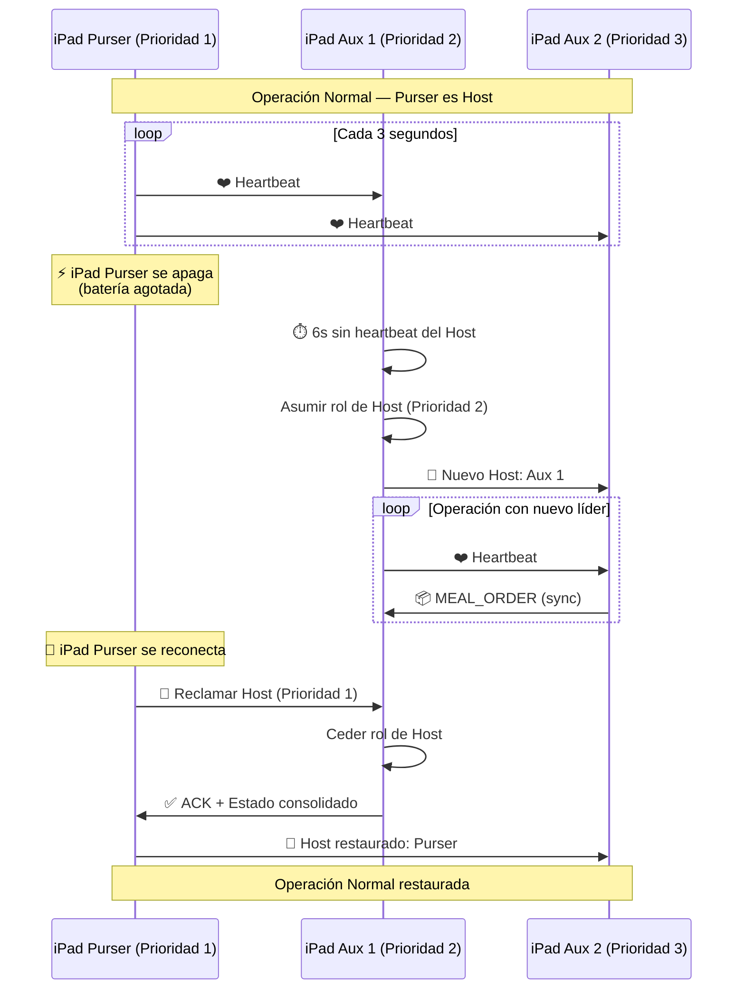
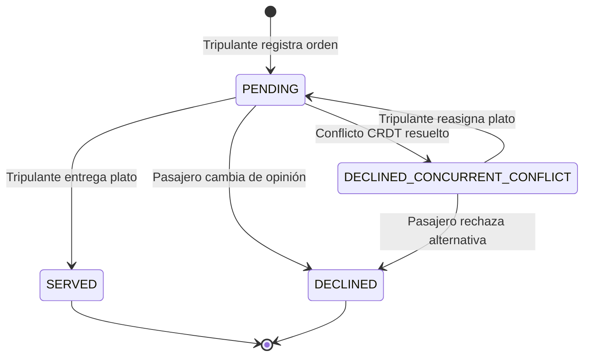
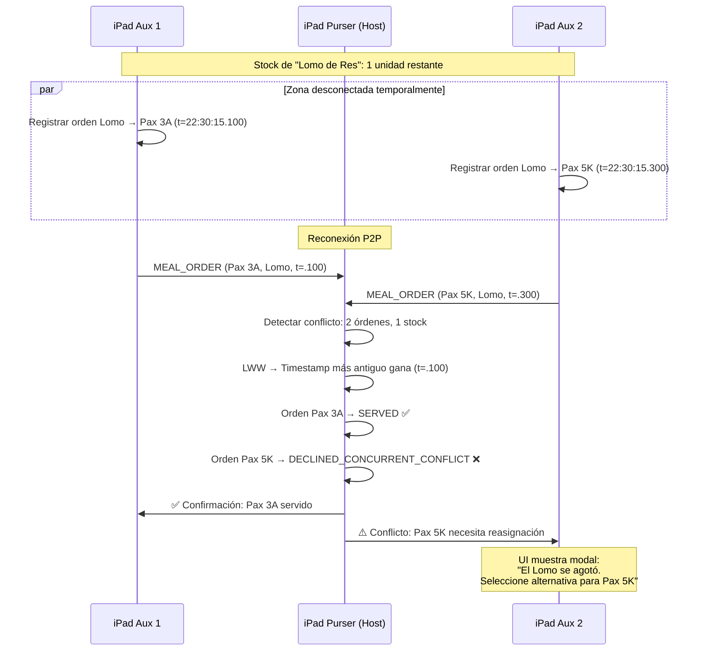
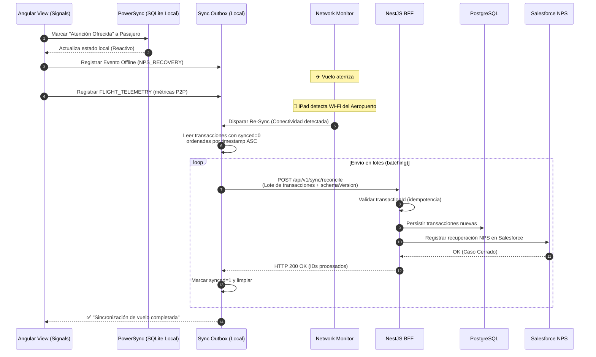
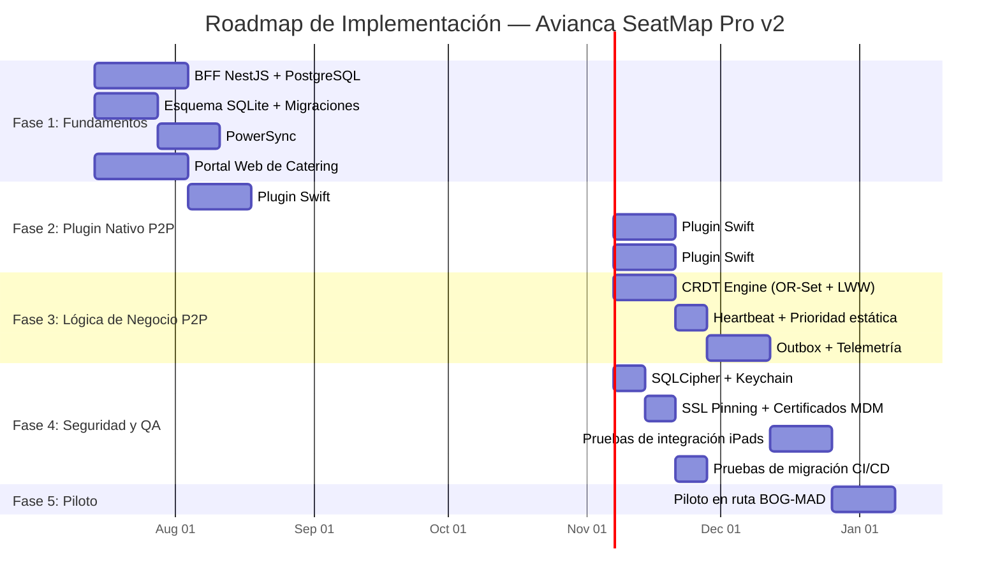

# Propuesta de Arquitectura v2: Avianca SeatMap Pro (Offline-First & P2P)

> **Versión 2.0** — Incorpora las mejoras identificadas en la [Segunda Opinión (SegOpinion.md)](file:///Users/jcgm/developer/pax-list-angular/SegOpinion.md) sobre la propuesta original.

Este documento detalla la arquitectura definitiva para **Avianca SeatMap Pro**, un sistema de soporte operativo a bordo diseñado para tripulantes de cabina (TC). El sistema opera de manera offline-first durante el vuelo, se sincroniza en tiempo real mediante comunicación P2P en el aire y consolida los datos de manera bidireccional al aterrizar en tierra.

---

## 1. Arquitectura General del Sistema

El flujo operativo se divide en tres fases críticas del vuelo:

1. **Fase de Embarque (Tierra):** La aplicación compilada con Capacitor descarga el manifiesto del vuelo (con soporte de **Delta Sync**), el inventario de catering, alertas NPS de Salesforce e información VIP de LifeMiles desde el BFF en tierra, guardando todo en la base de datos local **PowerSync + SQLite nativo**.
2. **Fase de Vuelo (Offline - P2P):** Conexión celular/Wi-Fi externa desconectada. Las tablets de la tripulación se descubren y comunican de forma descentralizada mediante un **plugin nativo de Apple Multipeer Connectivity** (`@avianca/capacitor-multipeer`) para sincronizar asignación de asientos, comandas de comida (via OR-Set CRDT) y estado del catering en tiempo real.
3. **Fase de Desembarque (Tierra/Re-sync):** Al recuperar conectividad, el motor de sincronización procesa la cola de transacciones locales pendientes (**Transactional Outbox**), incluyendo **telemetría de vuelo**, enviándolas al BFF para su reconciliación con los sistemas legados.



---

## 2. Backend-For-Frontend (BFF) en NestJS

El BFF centraliza la lógica de negocio consumida por los iPads, ocultando la complejidad y latencia de los sistemas legacy de la aerolínea y proporcionando un payload optimizado y ligero.

### A. Estructura de Endpoints (RESTful API)

| Método | Endpoint | Descripción |
|:-------|:---------|:------------|
| `GET` | `/api/v1/flights/:flightId/manifest` | Descarga el manifiesto completo o delta |
| `POST` | `/api/v1/sync/reconcile` | Recibe las transacciones Outbox del iPad |
| `POST` | `/api/v1/telemetry/flight-report` | Recibe la telemetría P2P del vuelo |
| `GET` | `/api/v1/flights/:flightId/catering` | Inventario de catering actualizado |

### B. Sincronización Inicial con Delta Sync (Pre-vuelo)

`GET /api/v1/flights/:flightId/manifest`

Soporta descarga completa o incremental mediante el header `If-Modified-Since` y un campo `lastSyncVersion`:

```json
{
  "syncVersion": 42,
  "flightInfo": {
    "id": "AV026",
    "origin": "BOG",
    "destination": "MAD",
    "departureTime": "2026-07-07T21:15:00Z",
    "aircraftType": "B788",
    "tailNumber": "N780AV"
  },
  "seats": [
    { "id": "1A", "cabin": "BUSINESS", "status": "OCCUPIED", "passengerId": "pax-101", "exitRow": false },
    { "id": "1C", "cabin": "BUSINESS", "status": "AVAILABLE", "passengerId": null, "exitRow": false }
  ],
  "passengers": [
    {
      "id": "pax-101",
      "firstName": "CARLOS",
      "lastName": "MENDOZA",
      "tier": "DIAMOND",
      "lifeMilesNumber": "123456789",
      "seatId": "1A",
      "ssr": ["WCHR", "VGML"],
      "npsAlert": {
        "hasAlert": true,
        "incidentId": "INC-88921",
        "description": "Pérdida de equipaje en vuelo anterior (AV002 BOG-MIA).",
        "actionOffered": false
      }
    }
  ],
  "catering": {
    "meals": [
      { "id": "meal-beef", "name": "Lomo de res con puré trufado", "category": "ENTREE", "initialStock": 8, "currentStock": 8 },
      { "id": "meal-chicken", "name": "Pollo al curry y vegetales", "category": "ENTREE", "initialStock": 6, "currentStock": 6 },
      { "id": "meal-pasta", "name": "Ravioli de espinaca y ricotta", "category": "PASTA", "initialStock": 4, "currentStock": 4 }
    ]
  }
}
```

Para vuelos con conexiones (tramos múltiples), el iPad envía `?lastSyncVersion=41` y el BFF responde solo con los registros modificados desde esa versión, reduciendo significativamente el tamaño del payload.

El BFF habilita compresión `gzip`/`brotli` en todas las respuestas HTTP mediante middleware estándar de NestJS.

### C. Re-sincronización Post-Vuelo

`POST /api/v1/sync/reconcile`

Recibe la cola Outbox completa del iPad, incluyendo ahora telemetría de vuelo:

```json
{
  "deviceId": "ipad-cabin-left-01",
  "appVersion": "2.1.0",
  "schemaVersion": 3,
  "syncedAt": "2026-07-08T06:45:10Z",
  "transactions": [
    {
      "transactionId": "tx-889102-129-aa",
      "timestamp": "2026-07-07T22:30:15Z",
      "type": "NPS_RECOVERY",
      "payload": {
        "passengerId": "pax-101",
        "incidentId": "INC-88921",
        "resolvedAt": "2026-07-07T22:29:45Z",
        "crewMemberId": "crew-4491"
      }
    },
    {
      "transactionId": "tx-889102-130-bb",
      "timestamp": "2026-07-07T23:10:00Z",
      "type": "MEAL_ORDER",
      "payload": {
        "passengerId": "pax-101",
        "seatId": "1A",
        "mealId": "meal-beef",
        "phase": "DINNER",
        "status": "SERVED"
      }
    },
    {
      "transactionId": "tx-telemetry-flight-026",
      "timestamp": "2026-07-08T06:40:00Z",
      "type": "FLIGHT_TELEMETRY",
      "payload": {
        "flightId": "AV026",
        "crdtConflictsResolved": 2,
        "p2pReconnections": 1,
        "leaderChanges": 0,
        "avgP2pLatencyMs": 85,
        "outboxPendingAtLanding": 12,
        "outboxCompletedAtLanding": 0
      }
    }
  ]
}
```

### D. Endpoint de Telemetría

`POST /api/v1/telemetry/flight-report`

Consolida los datos de telemetría de todos los iPads del vuelo y los expone en un dashboard operativo para el equipo de TI de Avianca. Registra:
- Número de conflictos CRDT resueltos durante el vuelo
- Reconexiones P2P y cambios de líder
- Latencia promedio de sincronización P2P
- Estado final del Outbox al aterrizar

### E. Patrones de Resiliencia e Integración Enterprise

Los sistemas de aerolíneas suelen presentar altas latencias o caídas imprevistas. El BFF implementa patrones defensivos estrictos:

```typescript
// service/dcs-integration.service.ts
import { Injectable, HttpException, HttpStatus } from '@nestjs/common';
import { HttpService } from '@nestjs/axios';
import { catchError, firstValueFrom, timeout } from 'rxjs';
import * as CircuitBreaker from 'opossum';

@Injectable()
export class DcsIntegrationService {
  private breaker: CircuitBreaker;

  constructor(private readonly httpService: HttpService) {
    const options = {
      timeout: 5000,                // Si DCS no responde en 5s, se considera fallo
      errorThresholdPercentage: 50,  // Abre el circuito si el 50% de peticiones fallan
      resetTimeout: 30000            // Intenta reabrir a los 30s (Half-Open)
    };

    this.breaker = new CircuitBreaker(this.fetchManifestFromDcs.bind(this), options);
    this.breaker.fallback(() => this.getFallbackManifest());
  }

  async getFlightManifest(flightId: string): Promise<any> {
    return this.breaker.fire(flightId);
  }

  private async fetchManifestFromDcs(flightId: string): Promise<any> {
    const dcsUrl = `${process.env.DCS_API_URL}/flights/${flightId}/manifest`;
    const response = await firstValueFrom(
      this.httpService.get(dcsUrl, {
        headers: { 'Authorization': `Bearer ${process.env.DCS_API_TOKEN}` }
      }).pipe(
        timeout(5000),
        catchError((err) => {
          throw new HttpException('DCS unavailable', HttpStatus.BAD_GATEWAY);
        })
      )
    );
    return response.data;
  }

  private getFallbackManifest(): any {
    return {
      status: 'FALLBACK_MODE',
      seats: [],
      passengers: []
    };
  }
}
```

* **Idempotencia Transaccional:** Cada transacción incluye un `transactionId` único (UUID). El BFF verifica en PostgreSQL si la transacción ya fue procesada antes de interactuar con Salesforce o el sistema de catering, previniendo duplicidades al reintentar envíos por fallos de red.



---

## 3. Base de Datos Local: PowerSync + SQLite Nativo (iPad OS)

### A. Justificación del Cambio (RxDB → PowerSync)

| Característica | RxDB + Capacitor SQLite | PowerSync + SQLite Nativo |
| :--- | :--- | :--- |
| **Bridge JS↔Nativo** | Serialización JSON bidireccional constante (overhead alto) | Sincronización en segundo plano a nivel SQLite nativo (overhead mínimo) |
| **Rendimiento >5000 docs** | Degradación exponencial por recálculo de observables RxJS | Consultas SQL nativas sin bridge, rendimiento lineal |
| **Reactividad Angular** | RxJS → requiere adaptadores para Signals | SDK con soporte reactivo, mapeable a Angular Signals |
| **Sincronización con Backend** | Configuración manual compleja | **Nativa con PostgreSQL** (el BFF ya usa PostgreSQL) |
| **Migraciones de Esquema** | `migrationStrategies` por versión (JSON) | **Migraciones SQL estándar** (ALTER TABLE, familiar para el equipo) |
| **Soporte Enterprise** | Comunidad | Empresa con soporte dedicado |

### B. Esquema de Datos Local (SQL — PowerSync/SQLite)

```sql
-- migrations/001_initial_schema.sql

CREATE TABLE IF NOT EXISTS passengers (
  id            TEXT PRIMARY KEY,
  first_name    TEXT NOT NULL,
  last_name     TEXT NOT NULL,
  tier          TEXT NOT NULL CHECK (tier IN ('DIAMOND', 'GOLD', 'SILVER', 'REGULAR')),
  lifemiles_number TEXT,
  seat_id       TEXT,
  ssr           TEXT, -- JSON array serializado: ["WCHR", "VGML"]
  nps_has_alert     INTEGER DEFAULT 0,
  nps_incident_id   TEXT,
  nps_description   TEXT,
  nps_action_offered INTEGER DEFAULT 0,
  nps_resolved_at   TEXT,
  updated_at    TEXT NOT NULL DEFAULT (datetime('now'))
);

CREATE TABLE IF NOT EXISTS meal_orders (
  id            TEXT PRIMARY KEY,
  passenger_id  TEXT NOT NULL REFERENCES passengers(id),
  seat_id       TEXT NOT NULL,
  meal_id       TEXT NOT NULL,
  phase         TEXT NOT NULL CHECK (phase IN ('WELCOME', 'DINNER', 'BREAKFAST')),
  status        TEXT NOT NULL CHECK (status IN ('PENDING', 'SERVED', 'DECLINED', 'DECLINED_CONCURRENT_CONFLICT')),
  ordered_at    TEXT NOT NULL,
  updated_at    TEXT NOT NULL DEFAULT (datetime('now')),
  device_id     TEXT NOT NULL -- iPad que registró la orden
);

CREATE TABLE IF NOT EXISTS catering_inventory (
  id             TEXT PRIMARY KEY,
  name           TEXT NOT NULL,
  category       TEXT NOT NULL,
  initial_stock  INTEGER NOT NULL,
  -- current_stock se CALCULA bajo demanda, no se almacena
  updated_at     TEXT NOT NULL DEFAULT (datetime('now'))
);

CREATE TABLE IF NOT EXISTS sync_outbox (
  id            TEXT PRIMARY KEY, -- UUID (transactionId)
  timestamp     TEXT NOT NULL,
  type          TEXT NOT NULL CHECK (type IN ('SEAT_CHANGE', 'NPS_RECOVERY', 'MEAL_ORDER', 'FLIGHT_TELEMETRY')),
  payload       TEXT NOT NULL, -- JSON serializado
  synced        INTEGER DEFAULT 0,
  retry_count   INTEGER DEFAULT 0,
  last_error    TEXT
);

-- Vista calculada: stock disponible de catering en tiempo real
CREATE VIEW IF NOT EXISTS catering_stock_available AS
SELECT
  ci.id,
  ci.name,
  ci.category,
  ci.initial_stock,
  ci.initial_stock - COALESCE(
    (SELECT COUNT(*) FROM meal_orders mo
     WHERE mo.meal_id = ci.id
     AND mo.status IN ('PENDING', 'SERVED')),
    0
  ) AS available_stock
FROM catering_inventory ci;

-- Índices para consultas frecuentes en cabina
CREATE INDEX IF NOT EXISTS idx_passengers_seat ON passengers(seat_id);
CREATE INDEX IF NOT EXISTS idx_passengers_tier ON passengers(tier);
CREATE INDEX IF NOT EXISTS idx_meal_orders_seat ON meal_orders(seat_id);
CREATE INDEX IF NOT EXISTS idx_meal_orders_meal ON meal_orders(meal_id, status);
CREATE INDEX IF NOT EXISTS idx_outbox_pending ON sync_outbox(synced, timestamp);
```

### C. Estrategia de Migración de Esquemas

Para manejar actualizaciones escalonadas vía MDM (donde dos iPads en el mismo avión podrían tener versiones diferentes de la app durante 24-48h):

```
migrations/
  001_initial_schema.sql
  002_add_meal_notes.sql
  003_add_crew_member_tracking.sql
```

**Reglas de migración:**
1. Cada migración es **aditiva** (agregar columnas, tablas o índices). Nunca eliminar columnas en producción.
2. Nuevas columnas siempre con `DEFAULT` para compatibilidad con versiones anteriores.
3. El campo `schemaVersion` en el payload de sincronización permite al BFF adaptar la respuesta según la versión del iPad receptor.
4. Las migraciones se ejecutan automáticamente al iniciar la app si detectan que la versión local es inferior.
5. El pipeline de CI/CD incluye **pruebas de migración** que validan la transición desde la versión N-2 hasta la actual.



---

## 4. Plugin Nativo: `@avianca/capacitor-multipeer`

No existe un plugin oficial ni comunitario mantenido de Capacitor para Apple Multipeer Connectivity. Se debe desarrollar un **plugin nativo en Swift** como módulo independiente.

### A. Arquitectura del Plugin



### B. API Pública del Plugin (TypeScript)

```typescript
// @avianca/capacitor-multipeer — Interfaz pública

export interface MultipeerPlugin {
  /** Inicia la publicación del servicio (el host/líder llama esto) */
  startAdvertising(options: { serviceType: string; displayName: string }): Promise<void>;

  /** Inicia la búsqueda de peers cercanos (los seguidores llaman esto) */
  startBrowsing(options: { serviceType: string }): Promise<void>;

  /** Envía datos JSON a un peer específico o a todos */
  sendData(options: { data: string; peerId?: string }): Promise<void>;

  /** Detiene la sesión P2P */
  disconnect(): Promise<void>;

  /** Listeners de eventos del bridge nativo */
  addListener(event: 'dataReceived', handler: (msg: { peerId: string; data: string }) => void): Promise<void>;
  addListener(event: 'peerStateChanged', handler: (info: { peerId: string; state: 'connected' | 'disconnected' | 'connecting' }) => void): Promise<void>;
}
```

### C. Principio de Separación de Responsabilidades

| Capa | Responsabilidad | Lenguaje |
|:-----|:----------------|:---------|
| **Plugin Swift** | Solo transporte: descubrir peers, conectar, enviar/recibir bytes | Swift |
| **TypeScript** | Toda la lógica de negocio: heartbeats, elección de líder, serialización de mensajes, resolución CRDT, consolidación de inventario | TypeScript |

Esta separación permite escribir **pruebas unitarias completas** de la lógica P2P en TypeScript/Jest sin necesidad de dispositivos físicos.

### D. Estimación de Desarrollo

| Fase | Duración | Entregable |
|:-----|:---------|:-----------|
| Prototipo del plugin (discover + send/receive) | 2 semanas | Plugin funcional en simulador |
| Integración con Angular + pruebas en dispositivos reales | 2 semanas | Plugin probado en iPads físicos |
| Hardening: reconexión, edge cases, certificados MDM | 1-2 semanas | Plugin listo para producción |
| **Total** | **5-6 semanas** | |

---

## 5. Sincronización P2P en Vuelo

### A. Topología: Estrella con Prioridad Estática

En lugar del Bully Algorithm (sobreingeniería para 2-4 nodos), se implementa una **tabla de prioridad fija configurada en tierra** antes del vuelo:

| Prioridad | Rol | Comportamiento |
|:---------:|:----|:---------------|
| **1** | iPad del Purser (Jefe de Cabina) | Host por defecto de la sesión MPC |
| **2** | iPad Pasillo Izquierdo (Auxiliar 1) | Primer fallback: asume host si Prioridad 1 no responde en 6s |
| **3** | iPad Pasillo Derecho (Auxiliar 2) | Segundo fallback |

**Protocolo de failover determinista:**
1. Cada iPad emite un heartbeat MPC cada **3 segundos**.
2. Si el iPad con Prioridad 2 detecta la desconexión del host (Prioridad 1) por más de **6 segundos** (2 heartbeats perdidos), asume inmediatamente la publicación del servicio P2P **sin fase de votación**.
3. Al reconectarse, el Purser reclama el rol de host automáticamente por su prioridad superior.
4. El cambio de líder se registra como evento de telemetría en el Outbox local.



### B. Protocolo de Mensajería P2P

```typescript
interface P2PMessage {
  messageId: string;       // UUID
  senderId: string;        // ID del iPad emisor
  timestamp: string;       // ISO String con precisión de ms
  schemaVersion: number;   // Para compatibilidad entre versiones de app
  action: 'SEAT_ASSIGNMENT' | 'MEAL_ORDER' | 'STOCK_SYNC' | 'NPS_RESOLVED' | 'HEARTBEAT' | 'LEADER_CLAIM';
  payload: any;
}
```

### C. Resolución de Conflictos: OR-Set de Comandas con Máquina de Estados

En lugar de un PN-Counter numérico (insuficiente), se sincroniza un conjunto **OR-Set (Observed-Remove Set)** de registros de comandas individuales con resolución **LWW (Last-Write-Wins)** a nivel de atributos.

**Máquina de estados de una comanda:**



**Cálculo del stock disponible (bajo demanda, no almacenado):**

```
Stock Disponible = Stock Inicial − Count(Comandas con status IN ('PENDING', 'SERVED'))
```

Esto se implementa como una **vista SQL** (`catering_stock_available`) que se consulta en tiempo real sin necesidad de mantener un contador separado.

**Flujo de resolución de conflicto concurrente:**



---

## 6. Protocolo de Re-sincronización en Tierra (Outbox Pattern)

### A. Ciclo de Vida del Outbox Local



### B. Escritura Atómica Local

Cualquier acción del tripulante ejecuta dos operaciones atómicas en la base de datos local:

```typescript
// service/outbox.service.ts — Angular Injectable

async recordNpsRecovery(passengerId: string, incidentId: string): Promise<void> {
  const now = new Date().toISOString();
  const txId = crypto.randomUUID();

  // Transacción SQLite atómica: actualizar pasajero + registrar en outbox
  await this.db.execute(`
    BEGIN TRANSACTION;

    UPDATE passengers SET
      nps_action_offered = 1,
      nps_resolved_at = ?,
      updated_at = ?
    WHERE id = ?;

    INSERT INTO sync_outbox (id, timestamp, type, payload, synced)
    VALUES (?, ?, 'NPS_RECOVERY', ?, 0);

    COMMIT;
  `, [now, now, passengerId, txId, now, JSON.stringify({
    passengerId,
    incidentId,
    resolvedAt: now
  })]);
}
```

### C. Detección de Red y Envío Secuencial

```typescript
// service/sync.service.ts

import { Network } from '@capacitor/network';

@Injectable()
export class SyncService {
  constructor(private db: DatabaseService, private http: HttpClient) {
    // Escuchar cambios de conectividad
    Network.addListener('networkStatusChange', async (status) => {
      if (status.connected && status.connectionType !== 'none') {
        await this.processOutbox();
      }
    });
  }

  private async processOutbox(): Promise<void> {
    const pending = await this.db.query(`
      SELECT * FROM sync_outbox
      WHERE synced = 0
      ORDER BY timestamp ASC
      LIMIT 50
    `);

    if (pending.length === 0) return;

    try {
      const response = await firstValueFrom(
        this.http.post('/api/v1/sync/reconcile', {
          deviceId: await this.getDeviceId(),
          appVersion: environment.appVersion,
          schemaVersion: CURRENT_SCHEMA_VERSION,
          syncedAt: new Date().toISOString(),
          transactions: pending
        })
      );

      // Marcar como sincronizadas
      const ids = pending.map(tx => `'${tx.id}'`).join(',');
      await this.db.execute(`
        UPDATE sync_outbox SET synced = 1 WHERE id IN (${ids})
      `);
    } catch (error) {
      // Incrementar retry_count y registrar error
      await this.db.execute(`
        UPDATE sync_outbox SET
          retry_count = retry_count + 1,
          last_error = ?
        WHERE synced = 0
      `, [error.message]);
    }
  }
}
```

---

## 7. Seguridad en Capas

```mermaid
graph TB
    subgraph "Capa 1: Datos en Reposo (iPad)"
        SQLC["SQLCipher AES-256<br/>Cifrado a nivel de página de BD"]
        KC["iOS Keychain<br/>Llave de cifrado protegida<br/>por Secure Enclave"]
        SQLC --- KC
    end

    subgraph "Capa 2: Datos en Tránsito P2P (Vuelo)"
        MPC_SEC["Multipeer Connectivity<br/>Cifrado asimétrico nativo"]
        CERT["Certificados autofirmados<br/>distribuidos vía MDM"]
        MPC_SEC --- CERT
    end

    subgraph "Capa 3: Datos en Tránsito HTTPS (Tierra)"
        TLS["TLS 1.3"]
        PIN["SSL Pinning<br/>en la app Capacitor"]
        TLS --- PIN
    end

    subgraph "Capa 4: Dispositivo (MDM)"
        MDM_P["Políticas MDM<br/>Passcode obligatorio"]
        WIPE["Remote Wipe<br/>en caso de pérdida"]
        SUP["Dispositivo Supervisado<br/>App Lock"]
        MDM_P --- WIPE
        WIPE --- SUP
    end
```



### Detalle de cada capa:

1. **En Reposo (iPad):** La base de datos SQLite física se encripta con **SQLCipher** (AES-256 a nivel de página). La llave de cifrado se almacena en el **iOS Keychain** protegida por el Secure Enclave del dispositivo. A diferencia de Apple Data Protection (que descifra automáticamente cuando el iPad está desbloqueado), SQLCipher mantiene la BD cifrada incluso con el dispositivo en uso, requiriendo que la app provea la clave en memoria para abrir el almacenamiento.

2. **En Tránsito P2P (Vuelo):** Multipeer Connectivity implementa cifrado asimétrico nativo. Se configura `securityIdentity` con certificados autofirmados generados durante el enrolamiento MDM para autenticar que solo iPads corporativos autorizados entren a la red de vuelo.

3. **En Tránsito HTTPS (Tierra):** Conexiones HTTPS obligatorias con validación de **SSL Pinning** en la app Capacitor para prevenir ataques Man-in-the-Middle en redes WiFi públicas de aeropuertos.

4. **A nivel de Dispositivo (MDM):** Políticas MDM que obligan a código de desbloqueo, capacidad de borrado remoto en caso de pérdida, y modo de dispositivo supervisado con App Lock para limitar el uso del iPad a la app operativa.

---

## 8. Estrategia de Pruebas

### A. Pruebas Unitarias (TypeScript/Jest)

| Módulo | Qué se prueba | Enfoque |
|:-------|:-------------|:--------|
| CrdtEngine | Resolución LWW de asientos, OR-Set de comandas, cálculo de stock | Mocks de timestamps, escenarios de conflicto |
| HeartbeatManager | Detección de desconexión, failover de líder por prioridad | Timers simulados, secuencias de heartbeat |
| OutboxService | Escritura atómica, envío secuencial, retry con backoff | Mock de Network API y HTTP |
| SyncService | Delta sync, compatibilidad de schemaVersion | Payloads de diferentes versiones |

### B. Pruebas de Integración (Dispositivos)

- **Escenario de concurrencia extrema:** Dos tablets enviando la orden del último plato simultáneamente al líder en un canal con 50% de pérdida de paquetes.
- **Escenario de failover:** Desconectar el iPad Purser durante una transacción de comanda activa y verificar que el Auxiliar 1 asume el rol de host y completa la operación.
- **Escenario de migración:** Un iPad con schema v2 y otro con schema v3 comunicándose por P2P sin pérdida de datos.

### C. Pruebas de Migración (CI/CD)

- Cada release ejecuta migraciones desde la versión N-2 hasta la actual sobre una BD poblada con datos de prueba.
- Se valida que no hay pérdida de datos ni corrupción de índices.
- Se verifica la compatibilidad hacia atrás del payload de sincronización.

---

## 9. Roadmap de Implementación



---

> **Nota:** Este documento reemplaza la [Propuesta de Arquitectura v1](file:///Users/jcgm/developer/pax-list-angular/PROPUESTA_ARQUITECTURA.md). Los archivos originales (`PROPUESTA_ARQUITECTURA.md` y `SegOpinion.md`) se conservan como referencia histórica del proceso de diseño.
